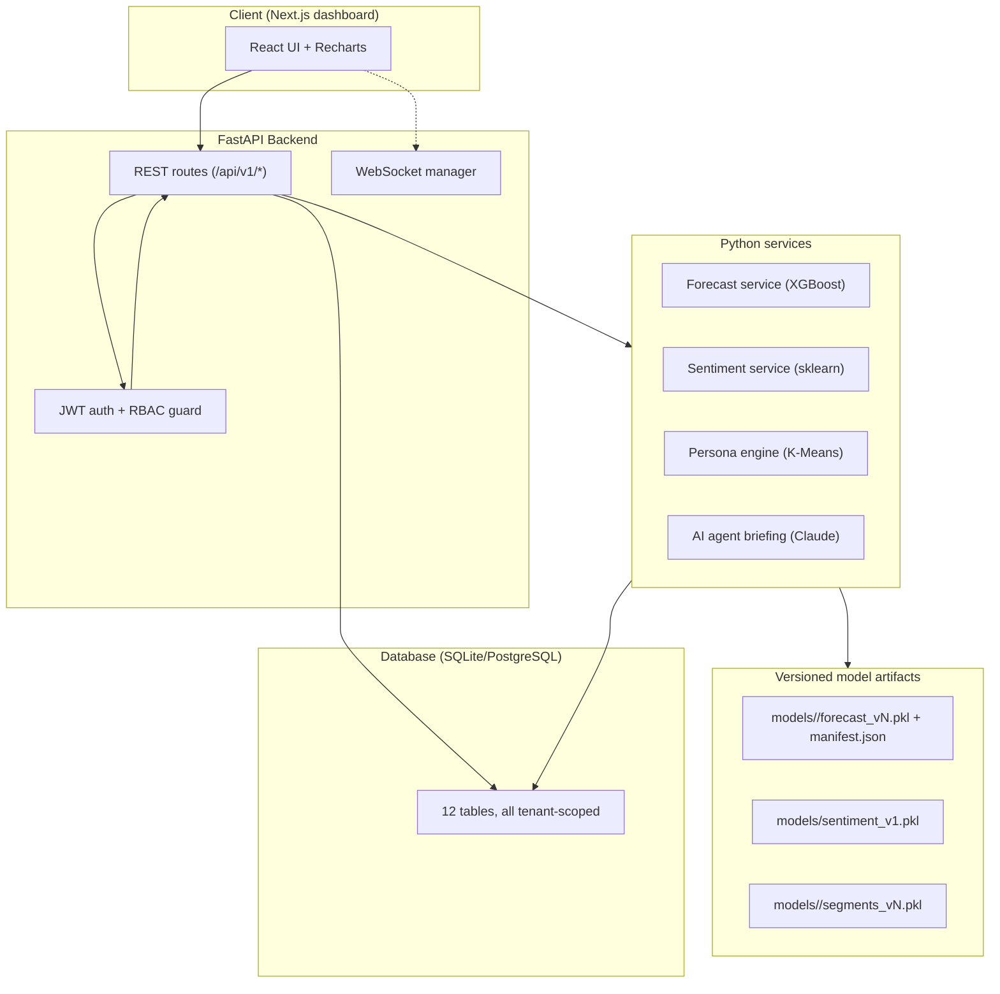

# OpsMind AI

[](app/main.py)
[](frontend)
[](requirements.txt)
[](frontend/tsconfig.json)
[](LICENSE)

**OpsMind AI is a multi-tenant restaurant operations intelligence platform — real-time sales tracking, XGBoost revenue forecasting, customer sentiment analysis, K-Means segmentation, and Anthropic Claude strategy briefings — with strict per-tenant data isolation.**

---

## Problem Statement

Restaurant operators juggle sales, inventory, staffing, and customer feedback across disconnected tools. OpsMind AI consolidates these into one multi-tenant SaaS platform where every restaurant (tenant) gets isolated data, role-based staff access, ML-driven forecasts, and AI-generated operational advice — without mixing data between customers.

## Project Objectives

1. **Multi-tenancy by design** — every table is scoped by `tenant_id`; no cross-tenant data leakage.
2. **Hard metrics locally, narrative via AI** — XGBoost/scikit-learn generate forecasts and sentiment scores; Anthropic Claude turns them into plain-language strategy.
3. **On-demand retraining** — versioned model artifacts with manifest tracking and rolling backtests.
4. **Operable locally and deployable** — FastAPI backend + Next.js frontend, Docker compose, SQLite default for local dev.

## Key Features

- **Multi-tenancy & RBAC** — JWT auth; three-tier roles (OWNER, MANAGER, STAFF); all queries scoped to the caller's tenant
- **Sales tracking** — CSV upload (`POST /api/v1/data/upload-sales`) with row-level validation and transactional inserts
- **Revenue forecasting** — XGBoost regressor predicts 3-day revenue; retrain on demand via `POST /api/v1/ml/retrain`
- **Customer sentiment** — TF-IDF + Logistic Regression classifier on reviews, with Claude/heuristic fallback when the model is absent
- **Customer segmentation** — K-Means clustering mapped to personas (VIP, At-Risk, Big Spender, Occasional)
- **AI strategy briefing** — Anthropic Claude translates ML outputs into pricing/labor/menu recommendations
- **Dashboards** — Next.js App Router UI with Recharts visualizations (revenue, top items, sentiment)
- **Model governance** — versioned `.joblib` artifacts, `manifest.json` per tenant, rolling 8-week backtest vs. naive baseline

## Technology Stack

| Layer | Choice | Purpose |
| --- | --- | --- |
| Backend | FastAPI (Python 3.10+) | Async API, automatic OpenAPI docs |
| Database | SQLAlchemy 2.0 async (SQLite default, PostgreSQL supported) | Multi-tenant ORM with `tenant_id` scoping |
| Auth | JWT (access + refresh) | Stateless sessions, role guards |
| Forecasting | XGBoost | 3-day revenue prediction |
| Sentiment | scikit-learn TF-IDF + Logistic Regression | Review classification |
| Segmentation | scikit-learn K-Means | Customer personas |
| Strategy | Anthropic Claude | Narrative advice from metrics |
| Frontend | Next.js 16, React 19, Tailwind CSS | App Router dashboard |
| Charts | Recharts | Revenue, top items, sentiment visuals |
| Data fetching | Axios + SWR | Authenticated client with caching |
| Container | Docker + docker-compose.yml | Reproducible local/dev deployment |

## Architecture Overview



- **Tenant isolation:** every model/table read is scoped by `tenant_id`; the scheduler retrains per tenant only when new sales exist since `manifest.json`'s `last_trained`.
- **Model serving:** `get_latest_model_path()` consults `manifest.json`, falls back to the pinned default (`forecast_v1.pkl`, `segments_v1.pkl`) if missing; sentiment degrades gracefully to Claude/heuristics when `sentiment_v1.pkl` is absent.
- **Deterministic output:** NaN/Infinity metrics are coerced to `null` in retraining responses so a successful retrain never becomes a 500.

## Repository Structure

```text
OpsMind-AI-Restaurant-Operations-Intelligence-System/
├── app/                    # FastAPI backend
│   ├── main.py             # App factory + route registration
│   ├── database.py         # Async SQLAlchemy engine/session
│   ├── api/                # REST routes (auth, sales, ml/retrain, data upload, ws, …)
│   ├── core/               # Config, security, scheduler, rate limiting, math utils
│   ├── ml/                 # Training pipelines (forecast, segmentation, sentiment), backtest, manifest helper
│   ├── models/             # SQLAlchemy models (12 tables, all tenant-scoped)
│   └── services/           # Business logic (forecast, sentiment, persona, strategy, analytics, …)
├── frontend/               # Next.js 16 dashboard (App Router, Tailwind, Recharts)
├── models/                 # Versioned ML artifacts + manifest.json (git-tracked checkpoints)
├── tests/                  # 20 pytest suites (53 tests, in-memory SQLite)
├── scripts/                # generate_sales_dataset.py, seed_data.py
├── docs/                   # ARCHITECTURE.md, DEMO.md, deployment.md, getting-started.md, roadmap.md, security.md, features/
├── Dockerfile / docker-compose.yml
├── .env.example            # Copy to .env and fill in secrets (never commit .env)
├── requirements.txt        # Pinned Python dependencies
├── pytest.ini              # asyncio backend pinned
└── README.md
```

## Environment Configuration

Copy `.env.example` to `.env` and set at minimum:

```env
# Database (SQLite works out of the box; switch to PostgreSQL for production)
DATABASE_URL=sqlite+aiosqlite:///./opsmind_demo.db

# JWT security — change these in production
SECRET_KEY=<strong random secret>
DEBUG=True
ENVIRONMENT=development

# AI/ML APIs
ANTHROPIC_API_KEY=<your-anthropic-key>   # strategy briefings; unset = heuristic fallback only
OPENWEATHER_API_KEY=<your-openweather-key>

# Application
APP_NAME=OpsMind AI
APP_VERSION=1.0.0
CORS_ORIGINS=["http://localhost:3000", "http://localhost:8000"]
```

`SECRET_KEY` is required; `ANTHROPIC_API_KEY` is optional — strategy endpoints degrade to heuristic advice when unset. `.env` is gitignored and must never be committed.

## Getting Started

### Backend

```bash
# 1. Create virtual environment
python -m venv .venv
# Windows: .venv\Scripts\activate
# macOS/Linux: source .venv/bin/activate

# 2. Install dependencies
pip install -r requirements.txt

# 3. Seed demo data (optional but recommended)
python scripts/seed_data.py

# 4. Start the API
uvicorn app.main:app --reload
# Visit http://localhost:8000/docs for the interactive OpenAPI reference
```

### Frontend

```bash
cd frontend
npm install        # or: npm ci
npm run dev        # http://localhost:3000
```

## ML Models & Evaluation

| Model | Algorithm | Purpose | Artifact |
| --- | --- | --- | --- |
| Revenue forecaster | XGBoost Regressor | 3-day sales forecast | `models/<tenant>/forecast_vN.pkl` |
| Customer segmentation | K-Means | Persona clustering | `models/<tenant>/segments_vN.pkl` |
| Sentiment classifier | TF-IDF + Logistic Regression | Review polarity | `models/sentiment_v1.pkl` |
| Strategy reasoning | Anthropic Claude | Narrative advice | API call (no artifact) |

Model artifacts are versioned per tenant; retraining increments the version and rewrites `manifest.json`. Old versions are retained so rollback is manual but possible.

**Backtest (verified against `reports/backtest.csv`):** across 8 rolling weekly windows, XGBoost MAE was below the naive lag-7 baseline in every window — no hardcoded "+34%" lift is claimed, since the CSV is the source of truth.

## Testing & Verification

Backend suite: **53/53 tests pass** (pytest, in-memory SQLite, asyncio pinned), covering auth cookies, RBAC, tenant isolation, sales import, forecast/service/persona/sentiment/training paths, backtest structure, scheduler lifecycle, and ML artifact loading.

CI (`.github/workflows/ci.yml`): Python 3.11, `flake8 app tests --select=E9,F63,F7,F82` (clean), then `python -m pytest -q`.

Frontend: `npm ci` + `npm run build` exit 0 (production build verified; `npm run lint` has pre-existing hook-dependency warnings not introduced here).

Quick local checks:

```bash
# Backend
flake8 app tests --count --select=E9,F63,F7,F82 --show-source --statistics
python -m pytest -q

# Frontend
cd frontend && npm ci && npm run build
```

## Known Limitations

1. **SQLite default** — fine for local dev/single-instance; production needs a durable PostgreSQL volume (ephemeral serverless storage will lose the DB on redeploy).
2. **Claude optional** — strategy briefings fall back to heuristics when `ANTHROPIC_API_KEY` is unset; this is by design, not a defect.
3. **No frontend test suite** — backend is fully tested; the Next.js dashboard has build verification but no unit/e2e tests yet.
4. **Artifact size** — trained `.joblib` files can exceed GitHub's file limits; pinned checkpoints are committed, future heavyweights should use Git LFS or Releases.

## Future Improvements

- Frontend unit/integration tests (Playwright or Vitest + React Testing Library)
- PostgreSQL migration path documented and tested
- Scheduled retraining wired to a persistent scheduler (cron/APScheduler with a durable store)
- Model artifact promotion gates (challenger vs. champion on backtest MAE)
- API rate limiting backed by Redis in production (currently bounded per-process in dev)

## Related Documentation

- [`docs/ARCHITECTURE.md`](docs/ARCHITECTURE.md) — full system design
- [`docs/deployment.md`](docs/deployment.md) — deployment notes
- [`docs/getting-started.md`](docs/getting-started.md) — step-by-step local setup
- [`docs/roadmap.md`](docs/roadmap.md) — planned work
- [`docs/security.md`](docs/security.md) — security model
- [`docs/features/`](docs/features/) — feature specs (menu, staff, AI usage, preferences)

## License

Released under the [MIT License](LICENSE).
